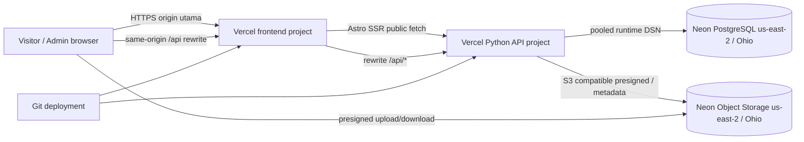

# 03 — Arsitektur Sistem dan Keputusan

## Konteks

Ini monolit modular kecil: satu aplikasi Astro, satu API FastAPI, satu Postgres dan object storage untuk satu pemilik. Tidak ada kebutuhan microservice atau event broker pada MVP. Batas antarlayer dibuat untuk memudahkan pengujian dan menjaga auth, domain rules, DB, dan storage agar tidak tercampur.

## Diagram arsitektur



Browser admin requests use the public host `/api/...` so cookie and Origin checks are same-origin. Astro SSR uses a server-side API origin for published reads. API is still protected by backend authorization; deployment URLs alone are not a security boundary. Public HTML is rendered per request initially so a successful publish can be reflected without waiting for a site build. Set a documented cache policy and test proxy behavior before adding CDN caching.

## Component boundaries

```text
frontend/src/pages/        Route templates; no SQL access
frontend/src/layouts/      Public/admin shells and metadata
frontend/src/components/   Accessible navigation, timeline, gallery, form controls
frontend/src/lib/api/      Typed server/browser API client; no secrets in browser bundle
frontend/src/styles/       Tokens, base, public, admin styles
frontend/src/scripts/      Small progressive-enhancement scripts

backend/app/api/v1/        Routers and dependency wiring
backend/app/core/          settings, logging, errors
backend/app/db/            engine, session dependency, transaction helpers
backend/app/models/        SQLAlchemy mapped tables
backend/app/schemas/       Pydantic request/response DTOs
backend/app/services/      domain operations, publication, media, auth
backend/app/security/      password, sessions, CSRF, rate limit
backend/app/integrations/  object storage adapter
backend/migrations/        Alembic revisions
backend/tests/             unit, DB, security and API tests
scripts/                   bootstrap admin, import/export utilities
```

Routers parse and validate input, call services and serialize response. Services own transactional behavior and cross-table rules. Repositories are not required as a generic abstraction; use SQLAlchemy queries in domain service modules until a real need to isolate them appears. All externally derived data is validated and output-escaped/rendered safely. Async FastAPI endpoints must await async DB/storage clients; do not put blocking synchronous IO inside `async def`.

## Rendering and freshness

- Astro pages for public content use request-time rendering and fetch only published API DTOs. HTML is indexable without JS. Project detail uses `/proyek/[slug]` with 404 for absent/unpublished slugs.
- `/admin/*` is request-time and `noindex`; it must validate session server-side for every admin read. Backend validates again for mutations.
- Static assets use versioned build names and CDN caching. Public images use immutable random object keys; updates create a new key and change metadata reference.
- MVP HTML/API freshness policy: no shared cache for admin or auth responses; public SSR response may be `private, no-store` initially to avoid serving unpublished/stale content. If latency warrants CDN caching, add explicit short `s-maxage`/`stale-while-revalidate` only after publish/unpublish invalidation behavior and draft isolation are tested. SEO does not require static generation.
- Server-side rendering adds function invocations and potential cold start; check it against actual content-update frequency, latency and Hobby allowance before production.

## ADR register

| ADR | Status | Keputusan | Alasan dan konsekuensi |
|---|---|---|---|
| ADR-001 | Diusulkan | Astro + TypeScript + CSS biasa; tanpa React/Tailwind. | Dominan konten, HTML server-rendered, interaksi minim dan CSS lama bernilai sebagai rujukan; komponen admin cukup native. |
| ADR-002 | Diusulkan | FastAPI modular monolith. | Satu API dan admin, tidak ada kebutuhan microservices. Vercel's current official docs support ASGI/FastAPI in Python Functions and list Python 3.12–3.14; verify entrypoint, dependency bundle and production behavior in a spike. |
| ADR-003 | Diusulkan | Pydantic v2 + SQLAlchemy 2.x + Alembic. | Validasi boundary terpisah dari ORM; migrasi eksplisit. Alembic autogenerate harus direview manual. |
| ADR-004 | Direvisi berdasarkan konfigurasi akun | Neon Postgres dan Object Storage `us-east-2` (Ohio), sesuai endpoint `indra` yang diberikan pemilik. | Dokumen lama menyebut Singapore sebagai kandidat, bukan konfigurasi akun. Preview branch/bucket belum dipastikan; jangan gunakan production data untuk preview. Region Neon bersifat tetap per project. |
| ADR-005 | Diusulkan | Neon Object Storage dengan S3-compatible client. | Satu penyedia, region Singapore dan free tier 5 GB menurut docs. Docs menyatakan API subset dan throttling 503 mungkin; validasi workflow nyata dan bucket access sebelum final. |
| ADR-006 | Diusulkan | Cookie-backed opaque sessions di Postgres; no JWT localStorage. | Kebutuhan satu admin, server-side logout/revocation, dan API write checks. Requires cleanup/expiry, CSRF, rate-limit design. |
| ADR-007 | Diusulkan, menunggu akun/repository | Dua Vercel Projects dari satu Git repo, root `frontend/` dan `backend/`. | Vercel Python Runtime saat ini berstatus Beta. Belum ada Git repository, project backend, atau autentikasi Vercel terverifikasi. Frontend memakai same-origin Astro BFF; jangan menambah external rewrite paralel tanpa uji cookie. |
| ADR-008 | Perlu verifikasi saat coding | SSR on-demand untuk route konten; cache HTML dimulai no-store. | Publish tampil tanpa rebuild dan detail SEO akurat; biaya invocation/cold start meningkat. Cache dapat ditambahkan sesudah invalidation dites. |
| ADR-009 | Diusulkan | No Redis, Better Auth, or multi-role framework in MVP. | Redis tidak perlu untuk satu admin; throttling dan sessions bisa disimpan Postgres dengan transaksi + cleanup. Better Auth tidak dipakai karena prompt meminta custom session dan MVP tidak butuh user management. |
| ADR-010 | Diusulkan | Frontend `/api/*` rewrite ke project backend untuk browser. | Browser tetap same-origin, cookie host-only dan CSRF Origin checks lebih sederhana. SSR server-to-server memakai API base URL private config. |
| ADR-011 | Perlu putus pemilik | Contact MVP menggunakan direct email/mailto; no persisted inbox. | Menghindari data pribadi, email provider, spam controls dan retention scope sampai kebutuhannya nyata. |

## Vercel topology comparison

| Pilihan | Status docs | Pertimbangan | Keputusan |
|---|---|---|---|
| Vercel Services satu project | Private Beta dan memakai `experimentalServices`; tersedia berdasarkan akses yang diberikan. Satu origin/domain, routing service path, env bersama. | Paling bersih untuk Astro+Python namun beta menambah risiko build, routing dan ketersediaan; tidak diasumsikan bisa dipakai. | Fallback optimization: aktifkan hanya setelah akun mendapat akses dan spike menguji cookie, rewrite, preview, deployment rollback, DB connection. |
| Dua Projects, monorepo | Didukung resmi; root directory per project; external rewrite dapat meneruskan `/api/*` tanpa browser mengubah URL. | Baseline paling dapat direncanakan; perlu dua deployment, backend upstream URL, preview mapping dan rewrite rules. Hobby punya limit proyek/deployment concurrency. | Baseline yang disarankan bila Python runtime tersedia. |
| Satu Vercel project dengan semua routes dalam Node | Memerlukan Python backend tidak sesuai rekomendasi stack. | Menambah runtime/bridge khusus. | Tidak dipilih. |

## Keputusan yang menahan implementasi

Fase coding jangan dimulai sampai pemilik menyetujui struktur `Indra` sebagai project scope, availability layanan akun, domain/URL publik, biaya yang dapat diterima, foto/CV dan sumber konten faktual. Detail deployment alternatif dan batas kuota ada di [09](09-deployment-and-environments.md); tradeoff SSR di [04](04-frontend-design-and-routing.md).
